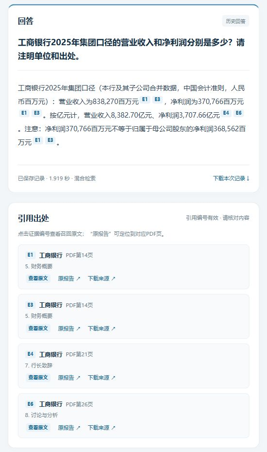
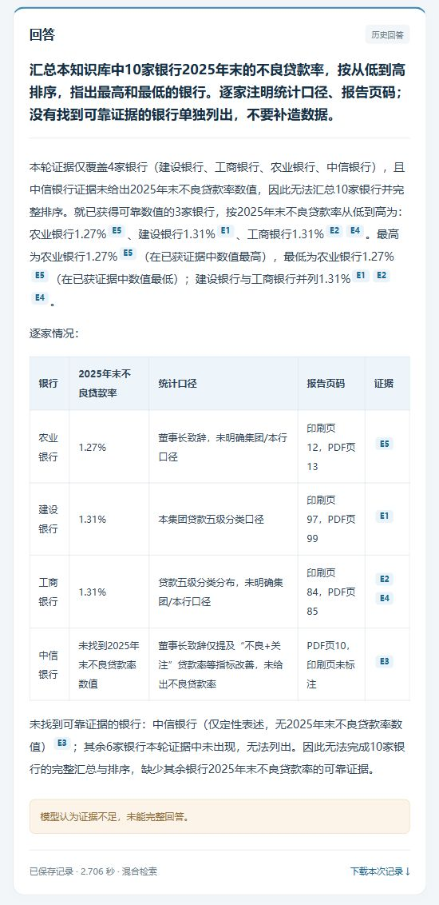

# 银行业年报问答知识库｜人工智能课程作业方向A

使用10家上市银行的2025年度报告构建RAG问答知识库：提取正文和表格，保留公司、章节及页码，用真实embedding向量与BM25混合检索，再由DeepSeek依据召回原文回答。网页展示回答、引用出处、召回块和基础版知识星空。

本项目是课程版实现，已完成10道题的正式评测，其中2道为跨公司全景题。保留第一次回答及错误记录，不将引用编号通过检查等同于答案正确。

## 数据来源

| 银行 | 股票代码 | 报告年度 |
|---|---|---|
| 工商银行 | 601398 | 2025 |
| 建设银行 | 601939 | 2025 |
| 农业银行 | 601288 | 2025 |
| 中国银行 | 601988 | 2025 |
| 交通银行 | 601328 | 2025 |
| 招商银行 | 600036 | 2025 |
| 兴业银行 | 601166 | 2025 |
| 浦发银行 | 600000 | 2025 |
| 中信银行 | 601998 | 2025 |
| 平安银行 | 000001 | 2025 |

报告全文来自巨潮资讯网。下载清单 [sources.csv](data/annual_reports/2025/sources.csv) 记录公告详情链接、PDF下载链接、文件名、披露日期和SHA-256。仓库不包含完整财报PDF，优先运行 `download_reports_from_manifest.py` 下载清单中固定版本，避免重查公告时选中不同修订版。另保留最初按公司查找公告的Node.js脚本 `download_annual_reports.mjs`，不作为默认复现入口。

## 实现方式

- **文档处理**：先处理工商银行和建设银行，再扩展到其余8家。正文约800字、重合120字，表格按完整行切块；保留公司、年度、章节、PDF页码、来源链接及质量标记。未经人工核对的列头、口径和印刷页码保留提示，不能视为全文已准确还原。
- **向量检索**：阿里云百炼 `text-embedding-v4`，1024维；文档使用 `document`，问题使用 `query`；向量归一化后以点积计算余弦相似度。
- **关键词检索**：jieba搜索分词、固定财务词汇、关闭HMM；BM25Okapi使用k1=1.5、b=0.75、epsilon=0.25。
- **混合检索**：每路取10个候选，使用RRF（常数60）融合，默认返回6个块，支持显式银行筛选。当前未实现逐银行补召回，全景问题可能缺少银行。
- **回答与出处**：请求模型 `deepseek-v4-flash`，正式评测时服务返回模型字段为 `deepseek-flash`，两者均保留在原始记录中。温度0.1、关闭思考、最大输出1800 tokens。程序依据实际召回块生成出处，引用编号检查只验证格式和存在性。
- **知识星空**：使用真实1024维向量的二维PCA投影，颜色区分银行，支持缩放、平移、原文查看及召回高亮。它是切块分布概览，不是知识图谱；二维距离不能代替原始向量相似度。

本轮处理了3801页PDF，形成12520个块，其中正文6406块、表格6114块。具体实现见各Python脚本和 `web/` 静态页面。

## 文件结构

```text
.
├── README.md / requirements*.txt / .env.example / .gitignore
├── download_reports_from_manifest.py    # 按来源清单下载固定PDF版本
├── process_pilot_reports.py             # 两家试点逐页提取
├── pilot_layouts.py                     # 样本表格及阅读顺序处理
├── prepare_course_chunks.py             # 两家课程版切块
├── prepare_all_banks.py                 # 扩展到10家银行
├── build_course_indexes.py              # 建向量与BM25索引
├── retrieval_core.py / search_course.py # 检索、缓存和指纹校验
├── answer_course.py / course_config.py  # 回答及本地配置
├── web_server.py / sky_projection.py    # 网页后端及PCA
├── web/                                # HTML、CSS、JavaScript
├── prompts/answer_system.txt            # 依据证据回答的系统提示词
├── formal_evaluation.py                 # 冻结依据并正式运行10题
├── summarize_formal_evaluation.py       # 导出人工核对判定
├── data/annual_reports/2025/sources.csv  # 下载来源及校验清单
└── data/processed/course_pilot/answers/formal/20261001-10questions/
    ├── questions.json / reference_answers.json
    ├── Q1.json … Q10.json / 同名Markdown
    ├── assessments.json / run_manifest.json / verification.json
    ├── 正式评测报告.md / 逐题评测记录.csv / 召回块明细.csv
    ├── reference_pages/ / audit_pages/   # 原PDF核对摘录
    └── screenshots/                    # 成功与失败页面截图
```

评测历史沿用早期 `course_pilot/answers/` 路径，但正式10题实际使用的是10家银行全量索引 `data/indexes/course_all/`。路径中的pilot不代表只评测两家银行。

## 在自己的电脑运行

使用Python 3.12；以下为Windows PowerShell示例，在仓库根目录执行。默认流程无需Node.js，也不依赖本作者的Codex运行时路径。

### 1. 安装依赖并配置模型

```powershell
python -m venv .venv
.\.venv\Scripts\python.exe -m pip install -r requirements.txt
Copy-Item -LiteralPath '.env.example' -Destination '.env'
```

在本地编辑 `.env`：填写 `DEEPSEEK_API_KEY`（回答模型）和 `DASHSCOPE_API_KEY`（embedding模型）。模型与接口地址可在模板中查看。首次建库和后续向量/混合查询都需要百炼密钥；生成新回答需要DeepSeek密钥。单独查看仓库内评测记录、截图和纯本地引用检查无需密钥。

`.env`只保留在本地，已由 `.gitignore` 排除；`.env.example`不包含真实密钥。前端通过本地Python服务调用模型，不向浏览器提供密钥。

### 2. 下载年报并生成切块

```powershell
.\.venv\Scripts\python.exe download_reports_from_manifest.py
.\.venv\Scripts\python.exe process_pilot_reports.py
.\.venv\Scripts\python.exe prepare_course_chunks.py
.\.venv\Scripts\python.exe prepare_all_banks.py --workers 2
```

固定清单下载完成后，PDF位于 `data/annual_reports/2025/`。处理过程会生成 `data/processed/pilot/`、`course_pilot/` 和 `course_all/` 的语料。全文处理需要等待；这些生成数据及运行缓存不放入提交副本。

### 3. 建索引

```powershell
# 先建两家索引，再在全量建库中复用同样的向量。
.\.venv\Scripts\python.exe build_course_indexes.py --chunks data/processed/course_pilot/chunks.jsonl --output data/indexes/course_pilot
.\.venv\Scripts\python.exe build_course_indexes.py
```

索引位于 `data/indexes/`，已被忽略。建库会实际调用百炼服务并产生用量；有效分批缓存可在中断后复用。不要为查看已保存的评测结果而重建索引。模型服务在未来可能变更，新运行不保证获得相同回答或评测结果。

### 4. 启动网页

```powershell
.\.venv\Scripts\python.exe web_server.py
```

打开 **http://127.0.0.1:8765/**。启动后会加载全量索引及已有正式评测历史；点击历史记录不重新调用模型，点击“生成回答”会产生新调用。原报告链接需要前面下载的本地PDF。

在整理后的提交副本中，也可执行 `启动问答页面.ps1`，它优先使用仓库的 `.venv`。原工作目录中的启动脚本仍可沿用本机运行时。

服务默认只监听本机 `127.0.0.1`。代码仓库地址不是在线问答服务地址，其他设备需自行运行项目。按Ctrl+C停止服务；端口占用可执行 `web_server.py --port 8766` 并打开对应地址。Linux/macOS可将命令中的Python路径换为 `.venv/bin/python`。

## 正式评测与结果

2026-10-01正式运行固定10题：Q1–Q6、Q8筛选对应银行；Q7、Q9、Q10在全部银行中检索。先依据原始PDF准备参照答案并冻结指纹，再每题生成一次，最后由Codex逐题核对，未调用另一个回答模型裁判。完整题目、原始响应、提示词、召回块、分数、页码、用量和判定都随仓库提供。

| 判定 | 题目 | 主要发现 |
|---|---|---|
| 正确：6题 | Q1–Q5、Q8 | 单公司数值、表格计算、正文解释及资料外正确拒答 |
| 部分正确：3题 | Q6、Q7、Q10 | 口径限定不充分、归母利润漏召回、全景覆盖不足 |
| 错误：1题 | Q9 | 全景覆盖不足，且最高值比较错误 |

本轮严格正确率60%，仅描述这10题。Q9召回4/10家、取得可靠数值3/10家；Q10召回5/10家、完整分析3/10家。`completed`只表示技术调用完成，不代表回答正确。资料内信息没有召回，不等同于Q8预设资料外问题的正确拒答。

- [正式评测报告](data/processed/course_pilot/answers/formal/20261001-10questions/正式评测报告.md)：逐题原始回答、对错、错误原因和出处。
- [逐题评测记录CSV](data/processed/course_pilot/answers/formal/20261001-10questions/逐题评测记录.csv)：10题结果。
- [召回块明细CSV](data/processed/course_pilot/answers/formal/20261001-10questions/召回块明细.csv)：60个完整召回块。
- [核对判定](data/processed/course_pilot/answers/formal/20261001-10questions/assessments.json)：逐题判定及原始记录指纹。





如需新一轮正式评测，使用新目录，避免覆盖本轮记录：

```powershell
.\.venv\Scripts\python.exe formal_evaluation.py prepare --directory data/processed/course_pilot/answers/formal/new-run
.\.venv\Scripts\python.exe formal_evaluation.py run --directory data/processed/course_pilot/answers/formal/new-run
```

两条命令分别准备PDF依据和执行真实API问答。人工核对后填写新轮次 `assessments.json`（可参照已提供格式；记录指纹必须对应新答案），再执行 `summarize_formal_evaluation.py --directory <新轮次目录>`。新轮次的措辞和结果不能直接沿用本轮判定。

## 验证命令

```powershell
# 纯本地验证，不调用外部模型。
.\.venv\Scripts\python.exe test_answer_citations.py
.\.venv\Scripts\python.exe download_reports_from_manifest.py --verify-only

# 网页已启动时运行；不生成新回答，不调用外部模型。
.\.venv\Scripts\python.exe test_web_server.py

# 可选：建好两家及全量索引后，校验并逐银行执行真实检索。
# 此项可能调用百炼生成新的问题向量。
.\.venv\Scripts\python.exe check_all_banks.py
```

原环境正式运行后，网页9项检查通过，10份回答及60个召回块完整，冻结依据和原始回答指纹一致，导出文件未发现API密钥。该历史验证记录不代替另一台电脑的实际运行检查。

## 作业提交

当前已准备代码、下载清单、页面截图和10题正式评测记录。下一步上传整理后的代码目录到GitHub或CNB，填写实际仓库地址；一页结论PDF尚需另行制作。提交文本为三行：

```text
方向：A
代码仓库：填写实际可访问的仓库地址
一句话结论：单公司事实与表格计算适合建立检索知识库；跨公司全景题受召回覆盖、统计口径及模型比较错误影响，需要依据真实评测结果分析。
```

不要上传 `.env`、完整财报PDF、向量索引、本地缓存或个人课件。提交副本已通过文件清单控制排除这些内容；上传前仍应查看Git实际待提交文件。
